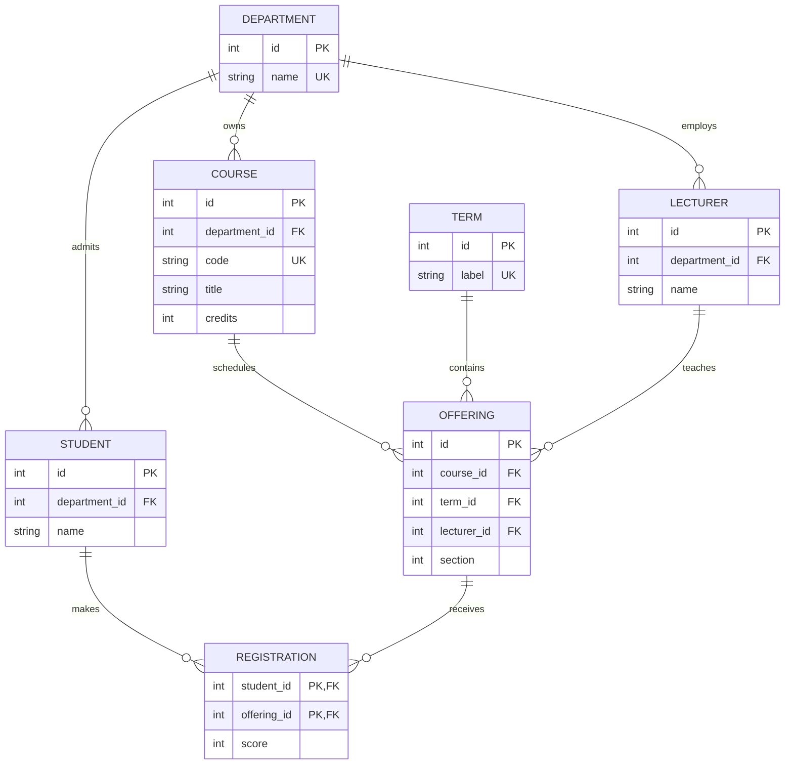

# Portfolio 1: Database Design and Modelling

**Student:** Rafiat Egunjobi  
**Course:** MIT 8103 Advanced Database Systems  
**Institution:** School of Postgraduate Studies, MIVA Open University  
**Case Study:** Riverside University Student Result Portal  

---

## 1. Case Study Overview

For my practical database portfolio, I selected the **Riverside University Student Result Portal**. The portal serves three primary user groups:
- **Students:** Register for course offerings each semester, track their continuous assessment marks, view published grades, and access semester transcripts.
- **Lecturers:** Access enrollment rosters for the sections they teach and record student marks (0–100).
- **Registry Staff:** Manage academic departments, configure courses and credit weights (1–6 credits), schedule course offerings (sections), and supervise student enrollment records.

---

## 2. Entity-Relationship (ER) Diagram



---

## 3. Relational Schema and Integrity Rules

The schema is defined in [`schema.sql`](schema.sql) using standard relational DDL:

- `department (id PK, name NOT NULL UNIQUE)`
- `student (id PK, department_id FK, name NOT NULL)`
- `lecturer (id PK, department_id FK, name NOT NULL)`
- `course (id PK, department_id FK, code NOT NULL UNIQUE, title NOT NULL, credits NOT NULL CHECK (typeof(credits) = 'integer' AND credits BETWEEN 1 AND 6))`
- `term (id PK, label NOT NULL UNIQUE)`
- `offering (id PK, course_id FK, term_id FK, lecturer_id FK, section NOT NULL CHECK (typeof(section) = 'integer' AND section > 0), UNIQUE (course_id, term_id, section))`
- `registration (student_id FK, offering_id FK, score CHECK (score IS NULL OR (typeof(score) = 'integer' AND score BETWEEN 0 AND 100)), PRIMARY KEY (student_id, offering_id))`

### Key Integrity Constraints:
1. **Composite Primary Key:** In `registration`, the primary key is `(student_id, offering_id)`. This guarantees at the database engine level that a student cannot register more than once for the same class section. The case-study policy allows one section per student, course, and term. Triggers enforce this on registration inserts and updates. A student can transfer the existing registration to another section. An enrolled offering retains its course and term.
2. **Grade Range Check:** Scores must be either `NULL` (when enrolled before grading) or an integer between 0 and 100:  
   `CHECK (score IS NULL OR (typeof(score) = 'integer' AND score BETWEEN 0 AND 100))`.
3. **Credit Unit Validation:** Course credits must be realistic academic values: `CHECK (typeof(credits) = 'integer' AND credits BETWEEN 1 AND 6)`.
4. **Offering Uniqueness:** `UNIQUE (course_id, term_id, section)` prevents duplicate section numbers for the same course in the same semester.
5. **Referential Integrity:** `PRAGMA foreign_keys = ON` enforces that registrations must link to valid students and offerings.

---

## 4. Normalisation Analysis (1NF to 3NF)

- **1NF (First Normal Form):** Every column stores single atomic values. There are no repeating groups or comma-separated lists, and every table has an unambiguous primary key.
- **2NF (Second Normal Form):** In the `registration` table with composite key `{student_id, offering_id}`, the non-key column `score` is fully functionally dependent on the entire composite key. A grade belongs to a specific student in a specific course offering. A student cannot have a single score without specifying the offering, nor does an offering have a single score without specifying the student. There are zero partial key dependencies.
- **3NF (Third Normal Form):** No non-key attribute depends transitively on the primary key:
  - Department names depend on `department.id`, not stored redundantly in `student` or `course`.
  - Course credits and titles depend on `course.id`, not stored in `offering` or `registration`.
  - Separating these reference entities eliminates update and deletion anomalies.

---

## 5. Constraint Verification Output

Running `python run.py` tests that database constraints are actively enforced:
- Attempting to insert a duplicate student registration triggers a primary key constraint error.
- Attempting to update a score to 101 triggers a check constraint error.
- Attempting to insert a registration for an invalid student ID triggers a foreign key error.

```text
1. Design and constraints
Rejected: UNIQUE constraint failed: registration.student_id, registration.offering_id
Rejected: CHECK constraint failed: score IS NULL OR (typeof(score) = 'integer' AND score BETWEEN 0 AND 100)
Rejected: FOREIGN KEY constraint failed
```
All foreign key integrity checks passed cleanly (`PRAGMA foreign_key_check` returned 0 violations).
