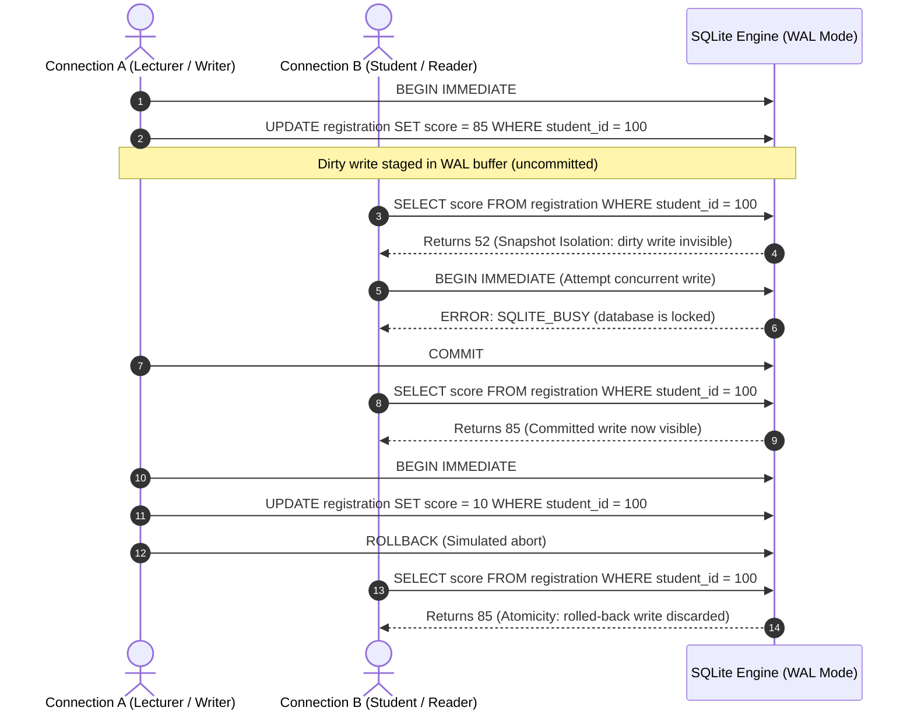

# Portfolio 3: Transactions and Concurrency

**Student:** Rafiat Egunjobi  
**Course:** MIT 8103 Advanced Database Systems  
**Institution:** School of Postgraduate Studies, MIVA Open University  
**Case Study:** Riverside University Student Result Portal  

---

## 1. Concurrency Requirements in the Result Portal

During examination grading and course registration periods, hundreds of students and faculty access the portal concurrently. The database engine must guarantee strict **ACID** properties:
- **Atomicity:** When an instructor uploads continuous assessment grades for a class, all scores in the batch must be saved, or none if an error occurs.
- **Consistency:** Marks must always satisfy integrity constraints (`0 <= score <= 100`) regardless of concurrent access.
- **Isolation:** A student viewing their result slip must never observe partially entered, uncommitted grades while an instructor is actively submitting marks.
- **Durability:** Once committed, grades must survive power failures or process crashes.

---

## 2. SQLite Write-Ahead Logging (WAL) Architecture

By default, SQLite uses rollback journal mode, where write operations place an exclusive lock on the database file, blocking concurrent readers.

To improve concurrency, the database operates in **WAL mode**:
```sql
PRAGMA journal_mode = WAL;
```

In WAL mode:
- Changes are appended to a separate `-wal` file rather than modifying the main database file directly.
- Readers read from a point-in-time snapshot of the database and never block writers.
- Writers append changes to the WAL file and never block readers.
- However, SQLite enforces a **single active writer at a time**. Concurrent write attempts must either wait or fail with a lock contention error (`SQLITE_BUSY`).

---

## 3. Two-Connection Concurrency Demonstration

In `run.py`, two independent SQLite connections (`writer` and `reader`) were configured with `timeout = 0` to observe concurrency boundaries:



### Analysis of the Results:
1. **Snapshot Isolation (Score: 52):**  
   While Connection A held an uncommitted update changing the score from 52 to 85, Connection B queried the score and observed 52. This proves that dirty reads are prevented.
2. **Writer Lock Contention (`database is locked`):**  
   When Connection B attempted `BEGIN IMMEDIATE` while Connection A held the write lock, the database engine actively raised `OperationalError: database is locked` (`SQLITE_BUSY`).
3. **Commit Visibility (Score: 85):**  
   Immediately following `writer.commit()`, the reader queried again and observed the committed score of 85.
4. **Atomicity and Rollback Verification (Score: 85):**  
   Connection A began another transaction, updated the score to 10, and issued `ROLLBACK`. The reader confirmed that the score remained 85, proving complete rollback atomicity.

---

## 4. Scaling Beyond SQLite in Enterprise Production

While SQLite WAL mode works well for local testing and lightweight applications, a full-scale university portal with thousands of concurrent lecturers and students requires an enterprise database engine such as **PostgreSQL**:
- **Row-Level Locking:** In PostgreSQL, multiple lecturers can submit grades for different courses simultaneously (`SELECT ... FOR UPDATE`) without blocking one another.
- **Connection Pooling & Busy Timeout:** Production servers configure connection pools (e.g., PgBouncer) and exponential backoff retry loops rather than letting queries fail immediately on contention.
- **Optimistic Concurrency Control (OCC):** Storing a `version` or `updated_at` column on grade records allows client applications to detect write-skew without long-held locks.
