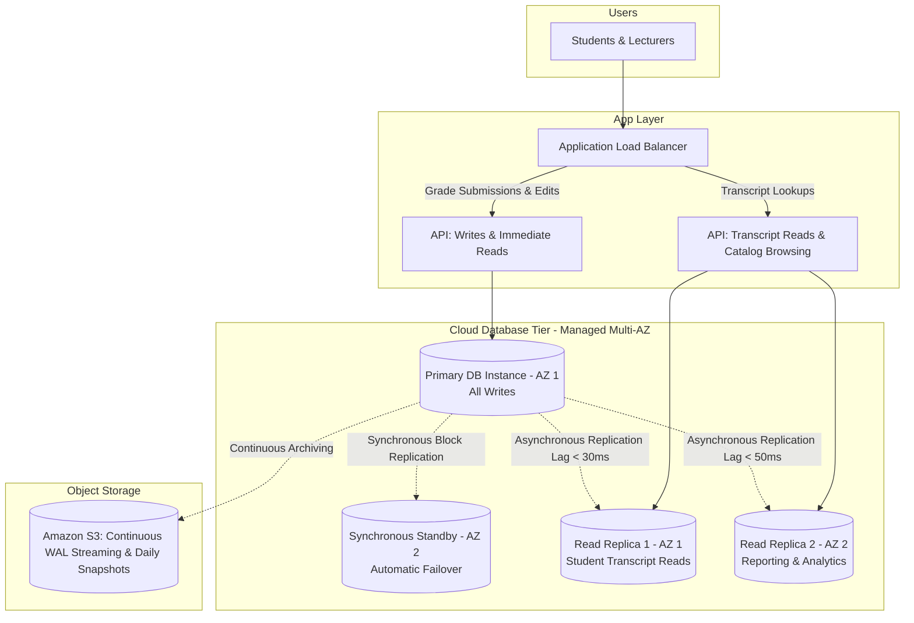

# Portfolio 5: Distributed and Cloud Database Architecture

**Student:** Rafiat Egunjobi  
**Course:** MIT 8103 Advanced Database Systems  
**Institution:** School of Postgraduate Studies, MIVA Open University  
**Case Study:** Riverside University Student Result Portal  

---

## 1. Cloud Architecture Overview

To support Riverside University's growing student population across regional campuses, the database architecture must provide high availability, read scalability, and reliable disaster recovery.

---

## 2. High Availability, Replication, and Failover

### Multi-AZ Deployment Model
- **Primary Database Instance (AZ-1):** Accepts all transactional write operations (`INSERT registration`, `UPDATE score`).
- **Synchronous Standby Instance (AZ-2):** Deployed in an independent Availability Zone. Writes are committed only after synchronous confirmation from the standby's storage layer. This guarantees **zero data loss (Recovery Point Objective, RPO = 0)** upon instance failure.
- **Automated Failover:** If AZ-1 experiences an infrastructure outage, the cloud orchestrator detects heartbeat loss, promotes the standby to primary, and updates DNS records automatically in **under 60 seconds (Recovery Time Objective, RTO < 60s)**.

### Aurora vs Traditional Multi-AZ RDS:
- In traditional RDS PostgreSQL/MySQL, replication to the standby is block-level across instances.
- In **Amazon Aurora**, the storage engine uses a virtualized shared cluster volume replicated six ways across three Availability Zones. Read replicas read from the same underlying storage volume, reducing replication lag to single-digit milliseconds.

---

## 3. Consistency, Replication Lag, and the "Read-Your-Own-Writes" Dilemma

Asynchronous read replicas are used to scale transcript lookups. However, asynchronous replication introduces a temporary lag (typically 10ms to 50ms).

### The Problem:
If an instructor submits final course marks and immediately clicks "View Class Roster" to verify their submission, the read request might be routed to a replica that is 40ms behind. The instructor would see the old scores, mistakenly believing their grade submission failed.

### The Solution:
1. **Session-Level Consistency (Read-After-Write Routing):** When an instructor session performs a write operation, the application flags the session and pins all read requests from that specific user to the **Primary database** for the next 5 to 10 seconds.
2. **Read Replica Pools:** General transcript browsing and catalog queries from students continue to hit read replicas, preserving system throughput.

---

## 4. Sharding and Partitioning Strategy

If Riverside University scales to millions of historical academic records across multiple campuses:

| Sharding Strategy | Shard Key | Advantages | Challenges |
| :--- | :--- | :--- | :--- |
| **Campus-Based Sharding** | `campus_id` | Clean physical isolation; high query locality for campus operations. | Data skew (flagship campus holds 70% of students); cross-campus course transfers require distributed joins. |
| **Hash-Based Student Sharding** | `student_id` | Perfectly balanced data distribution across shards; eliminates hot spots. | Class roster queries (`WHERE offering_id = ?`) must query every single shard and aggregate results. |
| **Recommended Hybrid Model** | **Functional Partitioning + Cold Archiving** | Keep active academic terms on a vertically scaled cloud cluster; archive graduated student terms into cold object storage (S3). | Eliminates cross-shard coordination; maintains full relational integrity for current semesters. |

---

## 5. Backups and Disaster Recovery

1. **Continuous Write-Ahead Log (WAL) Streaming:** Every transaction log segment is continuously backed up to Amazon S3.
2. **Point-in-Time Recovery (PITR):** Enables restoring the database to any specific second within the retention window (e.g., restoring to 2 minutes before an accidental bulk grade overwrite).
3. **Audit Immutability:** Historical grade updates trigger immutable audit records (`old_score`, `new_score`, `lecturer_id`, `timestamp`) written to an append-only audit table to satisfy accreditation and regulatory requirements.
