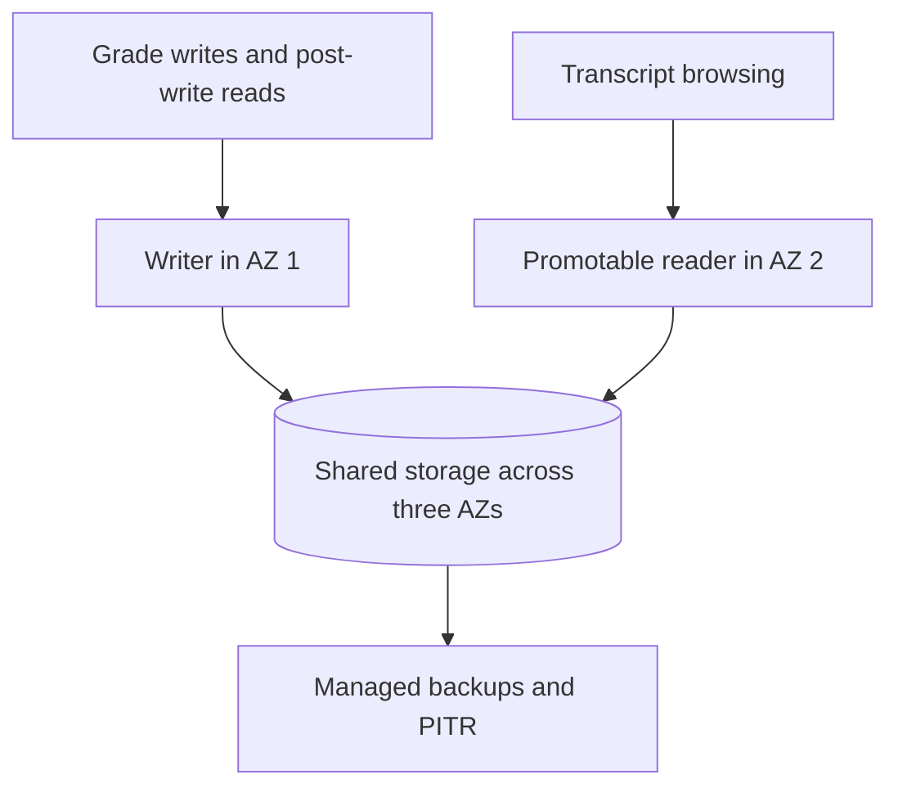

# Portfolio 5: Distributed and Cloud Database Architecture

**Student:** Rafiat Egunjobi  
**Course:** MIT 8103 Advanced Database Systems  
**Institution:** School of Postgraduate Studies, MIVA Open University  
**Case Study:** Riverside University Student Result Portal  

---

## 1. Cloud Architecture Overview

To support Riverside University's growing student population across regional campuses, the database architecture must provide high availability, read scalability, and reliable disaster recovery.

## 2. High Availability, Replication, and Failover

Aurora PostgreSQL synchronously replicates the shared storage volume across three availability zones. A reader instance in another AZ shares that volume and can be promoted if the writer fails. The design targets zero loss of committed data for a single-AZ failure. AWS describes failover with a promotable reader as typically under 60 seconds. End-to-end application recovery also depends on reconnecting through the cluster endpoint and would need to be measured. [AWS Aurora high availability](https://docs.aws.amazon.com/AmazonRDS/latest/AuroraUserGuide/Concepts.AuroraHighAvailability.html)

## 3. Read Routing and Replica Lag

Use reader instances for general transcript browsing. After a grade write, route the instructor’s reads to the writer. Return the session to a reader once the application can confirm the reader has applied the required change. A fixed pin alone can expire before the reader catches up. The writer is the fallback whenever catch-up cannot be confirmed.

## 4. Sharding and Partitioning Strategy

If Riverside University scales to millions of historical academic records across multiple campuses:

| Sharding Strategy | Shard Key | Advantages | Challenges |
| :--- | :--- | :--- | :--- |
| **Campus-Based Sharding** | `campus_id` | Clean physical isolation; high query locality for campus operations. | Data skew (flagship campus holds 70% of students); cross-campus course transfers require distributed joins. |
| **Hash-Based Student Sharding** | `student_id` | Distributes students across shards; workload skew can still occur. | Class roster queries (`WHERE offering_id = ?`) must query every single shard and aggregate results. |
| **Recommended Hybrid Model** | **Functional Partitioning + Cold Archiving** | Keep active academic terms on a vertically scaled cloud cluster; archive graduated student terms into cold object storage (S3). | Eliminates cross-shard coordination; maintains full relational integrity for current semesters. |

---

## 5. Backups and Disaster Recovery

1. **Managed Backups:** Aurora automated backups support point-in-time restore within the configured retention window.
2. **Point-in-Time Recovery (PITR):** Enables restoring the database to any specific second within the retention window (e.g., restoring to 2 minutes before an accidental bulk grade overwrite).
3. **Audit Immutability:** Historical grade updates trigger immutable audit records (`old_score`, `new_score`, `lecturer_id`, `timestamp`) written to an append-only audit table to satisfy accreditation and regulatory requirements.

## 6. Proposed Failover Verification

In a staging cluster with a writer and promotable reader in separate AZs, send numbered grade transactions and record their acknowledgements. Trigger a managed failover while the client retries through the cluster endpoint. Measure elapsed time until the first successful post-failover write and read, then verify that every acknowledged transaction is present. Record missing acknowledgements separately and reconcile them using the transaction IDs. This procedure measures application recovery and checks the scoped data-loss target.
